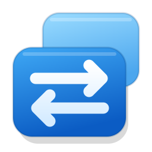
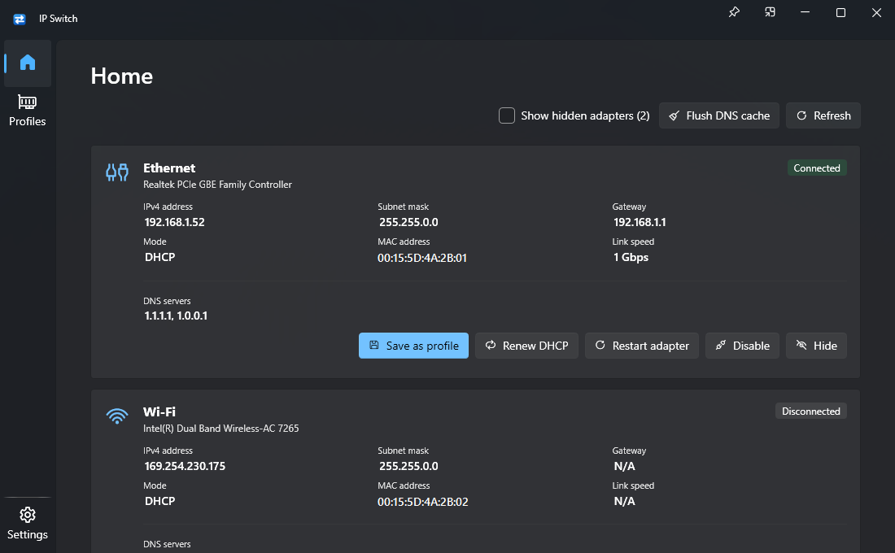
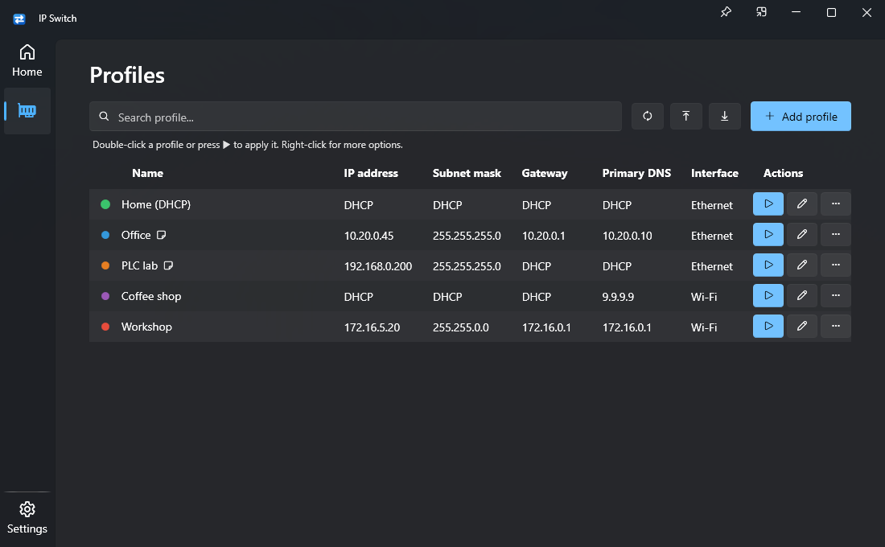
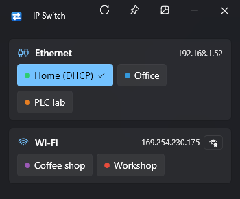
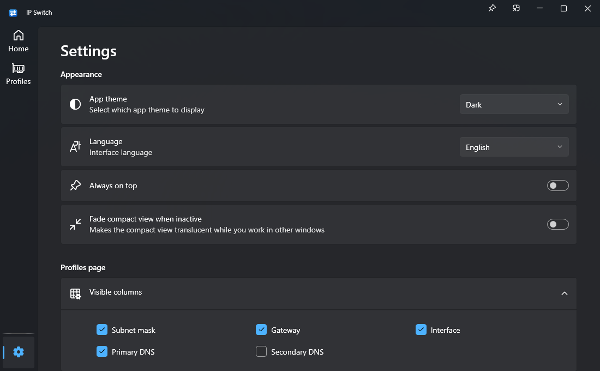
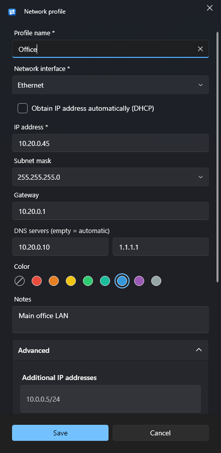

<div align="center">



# IP Switch

**Switch your Windows network configuration in one click.**<br>
Save IPv4 profiles per adapter and apply them from the app, the tray, a hotkey, the command line or automatically on WiFi.

[](https://github.com/magancete/IP-Switch/actions/workflows/build.yml)
[](https://github.com/magancete/IP-Switch/releases/latest)
[](https://github.com/magancete/IP-Switch/releases)


[](LICENSE)

[**Download**](https://github.com/magancete/IP-Switch/releases/latest/download/IPSwitch.exe) ·
[Features](#features) ·
[Usage](#usage) ·
[Build](#building-from-source) ·
[🇪🇸 Español](README.es.md)

<picture>
  <source media="(prefers-color-scheme: light)" srcset="docs/images/home-light.png">
  
</picture>

</div>

---

## Why IP Switch?

Changing a static IP in Windows means digging through *Control Panel → Network Connections → Properties → IPv4* every time. If you move between an office LAN, a lab with fixed addresses and your home DHCP, **IP Switch turns that into one click** — and if a profile leaves you without connectivity, it **rolls back automatically**.

- **No installation.** A single ~3 MB `.exe` on .NET Framework 4.8, already part of Windows 10 (1903+) and 11.
- **Safe.** Connectivity is verified after every change, with an automatic rollback countdown.
- **Native look.** Fluent design with Mica, light and dark themes, like Windows 11 Settings.
- **Private.** No telemetry; the only optional connection is the update check against GitHub.

## Features

<table>
<tr>
<td width="50%" valign="top">

**Profiles**
- Static IP or DHCP, mask, gateway with metric, primary/secondary DNS
- Additional IP addresses on the same adapter
- Color label, notes, duplicate, search and sort
- Active profile detection
- Import/export as JSON

</td>
<td width="50%" valign="top">

**Apply anywhere**
- Main window, compact view and tray panel
- Global hotkeys (e.g. `Ctrl+Alt+1`)
- Automatically when joining a WiFi network
- Command line `--apply "Office"` and desktop shortcuts
- Connectivity check with automatic rollback

</td>
</tr>
<tr>
<td valign="top">

**Adapters**
- IP, mask, gateway, DNS, MAC, speed and mode at a glance
- Renew DHCP, restart, enable/disable, flush DNS
- Hide adapters you never use (remembered)
- Open the Windows WiFi networks panel

</td>
<td valign="top">

**App**
- English and Spanish, switchable live
- Light, dark or system theme
- Single instance, starts with Windows (optional)
- Responsive layout, per-monitor DPI

</td>
</tr>
</table>

## Screenshots

<table>
<tr>
<td align="center"><br><sub><b>Profiles</b> — apply with ▶ or a double-click</sub></td>
<td align="center"><br><sub><b>Compact view</b> — one button per profile</sub></td>
</tr>
<tr>
<td align="center"><br><sub><b>Settings</b></sub></td>
<td align="center"><br><sub><b>Profile editor</b></sub></td>
</tr>
</table>

## Getting started

1. Download [`IPSwitch.exe`](https://github.com/magancete/IP-Switch/releases/latest/download/IPSwitch.exe) from the latest release.
2. Put it anywhere (e.g. `C:\Tools\` or a USB drive) and run it. Accept the UAC prompt: changing the IP configuration requires administrator rights.
3. On **Home**, click **Save as profile** on an adapter, or create one in **Profiles → Add profile**.

> [!TIP]
> Windows SmartScreen may warn about an unsigned executable: click *More info → Run anyway*. You can verify the download with the `IPSwitch.exe.sha256` file published with each release.

**Requirements:** Windows 10 version 1903 or later, or Windows 11 (tested on x64) · .NET Framework 4.8 (built in) · administrator rights.

**Uninstall:** turn off *Start with Windows* in Settings if you enabled it, then delete `IPSwitch.exe` and the `%AppData%\IPSwitch` folder.

## Usage

### Applying a profile safely

1. IP Switch takes a snapshot of the adapter's current configuration.
2. It applies the profile with `netsh` (address, additional IPs and DNS).
3. It pings the gateway (or a host of your choice) for a few seconds.
4. If nothing answers, it asks **"Keep this network configuration?"** and restores the previous one when the countdown ends.

### Compact view and tray

- **Compact view** — title-bar button next to minimize. A small, resizable window with one button per profile; it can stay on top and fade when inactive. Its height always fits all your adapters.
- **Tray icon** — click for the quick panel, double-click for the window, right-click for *Apply profile ▸*. The tooltip shows the active profile or IP of each adapter.

### Hotkeys and WiFi auto-switch

In the profile editor (**Advanced**) you can assign a global hotkey with at least one modifier, and — for WiFi adapters — an SSID that applies the profile automatically when you join that network.

### Command line

```text
IPSwitch.exe [options]

  --apply "Name"   Applies the profile and exits (0 = success, 1 = error, 2 = not found)
  --minimized      Starts hidden in the notification area
  --compact        Starts in the compact view
  --help           Shows the help
```

`--apply` works in scripts and Task Scheduler. If IP Switch is already running, the request is forwarded to it and the exit code is returned. *Create desktop shortcut* (⋯ menu of a profile) builds a shortcut that runs `--apply` for that profile.

### Settings

| Section | Options |
|---|---|
| Appearance | Theme, language, always on top, fade the compact view |
| Profiles page | Visible columns |
| Connection check | On/off, host to check (empty = gateway), time before rolling back |
| System & behavior | Start with Windows, tray click action, close to the notification area, confirm before exiting |
| About | Updates, data folder, **report a bug or suggest an improvement** |

## Data and privacy

| File | Content |
|---|---|
| `%AppData%\IPSwitch\profiles.json` | Profiles |
| `%AppData%\IPSwitch\settings.json` | Settings, including hidden adapters |

- Data is **never** stored next to the executable, so the `.exe` can be replaced or live in a read-only folder. Data from older portable builds (`IPSwitch-data` next to the `.exe`) is copied on first run.
- The `IPSWITCH_DATA_DIR` environment variable overrides the folder (fully portable setups, tests).
- IP Switch collects nothing. The optional update check queries `api.github.com` and never downloads or installs by itself. Feedback opens GitHub in your browser; nothing is sent automatically.

## Building from source

Requirements: Windows, [.NET SDK](https://dotnet.microsoft.com/download) 8 or later and the .NET Framework 4.8 targeting pack (included with Visual Studio).

```powershell
git clone https://github.com/magancete/IP-Switch.git
cd IP-Switch
./build.ps1          # resource checks + Release build (0 warnings) + tests → artifacts\IPSwitch.exe
```

Open `IPSwitch.slnx` in Visual Studio 2022 17.13+ to work in the IDE. To try the UI without UAC (network changes will fail) and with throwaway data:

```powershell
$env:__COMPAT_LAYER = 'RunAsInvoker'; $env:IPSWITCH_DATA_DIR = "$env:TEMP\ipswitch-dev"; .\artifacts\IPSwitch.exe
```

### Project layout

```text
IP-Switch/
├── src/IPSwitch/            WPF application (Windows, Pages, Controls, ViewModels, Models, Services, Resources)
├── tests/IPSwitch.Tests/    Unit tests (xUnit)
├── tests/Integration/       Administrator integration tests against a real adapter
├── tools/                   Resource checks and icon export (vector AppIcon.xaml → favicon.ico)
├── docs/                    Architecture and screenshots
├── .github/                 CI workflow, issue forms and pull request template
├── build.ps1                Build, test and package
└── Directory.Build.props    Version and settings shared by every project
```

### Tests

| Type | Command | Coverage |
|---|---|---|
| Unit | `dotnet test` | IP validation, generated `netsh` commands, hotkeys, command line, single instance, data folder, adapter snapshot, profiles, import/export, updates |
| Resources | `./tools/Check-Resources.ps1` | English/Spanish keys match; every text and icon used exists |
| Integration | `tests/Integration/Invoke-AdminIntegrationTests.ps1` | Real changes on a test adapter (static, secondary IP, DNS, DHCP, rollback, enable/disable, startup task, `--apply`, hotkeys), restored at the end |

CI (GitHub Actions) runs the resource checks, the build with warnings as errors and the unit tests on every push and pull request. Pushing a `vX.Y.Z` tag attaches the executable and its SHA-256 to the release.

More detail in [docs/ARCHITECTURE.md](docs/ARCHITECTURE.md).

## Troubleshooting

| Problem | Solution |
|---|---|
| "Could not apply…" with a `netsh` message | The message comes from Windows. Check that the IP is not used by another adapter and the adapter is enabled. |
| It rolls back although the network works | The gateway does not answer ping. Set another host in *Settings → Host to check* or turn the check off. |
| A hotkey does not work | Another application uses it (you will see a warning). Choose another one. |
| It does not start with Windows after moving the `.exe` | Turn *Start with Windows* off and on again. |
| An adapter is missing | It may be hidden (*Show hidden adapters*) or be an excluded virtual adapter. |
| Nothing happens when launching it | It is already running: look for its icon in the notification area. |

## Contributing

Bug reports, ideas and pull requests are welcome — see [CONTRIBUTING.md](CONTRIBUTING.md). From the app, **Settings → About → Report a bug or suggest an improvement** opens the [issue chooser](https://github.com/magancete/IP-Switch/issues/new/choose) with ready-made forms. Security issues: see [SECURITY.md](SECURITY.md).

## License

[MIT](LICENSE) © 2026 Carlos Magán. Embedded dependencies, all MIT-licensed: [WPF-UI](https://github.com/lepoco/wpfui), [CommunityToolkit.Mvvm](https://github.com/CommunityToolkit/dotnet) and [Costura.Fody](https://github.com/Fody/Costura).
