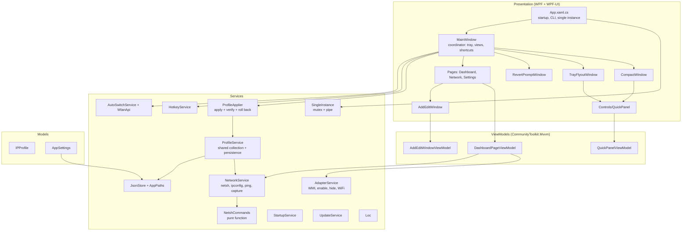
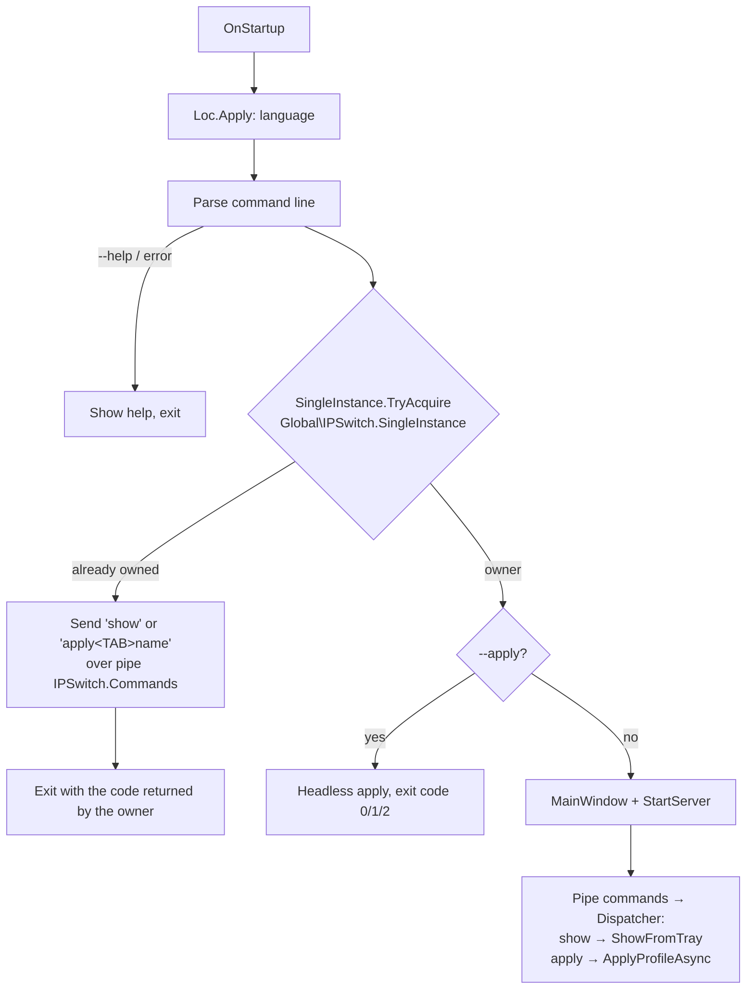
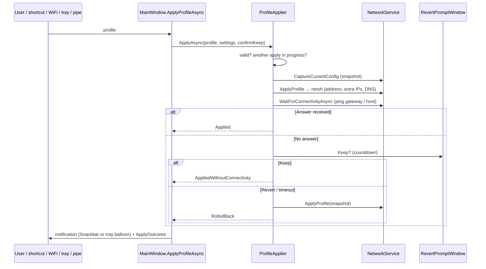

# IP Switch architecture

This document describes how the application is organized, its main flows and its design decisions. For usage, see the [README](../README.md).

## Goals and constraints

1. **A single small portable executable (~3 MB)** that runs on any Windows 10 (1903+) / 11 without installing anything.
2. **Safe network changes**: never leave the user offline because of a configuration mistake.
3. **No unnecessary dependencies**: every NuGet package grows the executable.

These drive the technical decisions:

| Decision | Reason | Rejected alternative |
|---|---|---|
| **.NET Framework 4.8** (`net48`) | Preinstalled on Windows 10 1903+ and 11. | .NET 8/10 self-contained (~70 MB) or framework-dependent (requires installing the runtime). |
| **Costura.Fody** | Embeds WPF-UI and CommunityToolkit.Mvvm into the `.exe` → a single file. | Shipping several DLLs. |
| `JavaScriptSerializer` | Included in .NET Framework. | System.Text.Json (+ ~1 MB of dependencies). |
| `System.Windows.Forms.NotifyIcon` | Included in .NET Framework. | WPF-UI.Tray (pulls System.Drawing.Common on net48). |
| `netsh` / `ipconfig` / `schtasks` | Standard Windows tools, no complex P/Invoke. | IP Helper API (much more code). |
| WMI (`Win32_NetworkAdapter`) | The only simple, language-independent way to list **disabled** adapters. | Parsing the localized output of `netsh`. |
| Native WLAN API | Language-independent connected SSID. | Parsing `netsh wlan show interfaces`. |
| Named `Mutex` + named pipe | Single instance and command forwarding with BCL types only. | WCF / remoting / third-party IPC. |
| `LangVersion=latest` | Modern C# on net48. | The BCL is still net48's: see [Limitations](#net48-limitations). |
| Costura **compression on** | 3.3 MB executable; measured the same startup time and ~20 MB less memory than uncompressed (7.6 MB). | `DisableCompression`. |

## Repository layout

| Path | Content |
|---|---|
| `src/IPSwitch/` | The WPF application (`IPSwitch.csproj`) |
| `tests/IPSwitch.Tests/` | Unit tests (xUnit, net48) |
| `tests/Integration/` | Administrator integration tests against a real adapter |
| `tools/` | `Check-Resources.ps1` (localization keys and icons) and `Export-Icon.ps1` (renders `Resources/AppIcon.xaml` into `favicon.ico`) |
| `Directory.Build.props` | Version, target framework and settings shared by every project |
| `build.ps1` | Restore, checks, Release build with warnings as errors, tests, `artifacts\IPSwitch.exe` + SHA-256 |
| `.github/` | CI workflow, issue forms (bug, feature, documentation, question) and pull request template |

## Layers

- **Models**: plain persistable data. `IPProfile` contains its own validation (`GetValidationErrorKey`) so the rules live in one testable place.
- **Services**: logic with no view dependencies. The pure parts (`IpUtils`, `NetshCommands`, `HotkeyService.TryParse/Format`, `CommandLineOptions`, `SingleInstance.BuildApplyCommand/TryParseApplyCommand`, `UpdateService.TryParseVersion`, `ProfileTransferService`, `WidthToColumnsConverter.Calculate`) are covered by unit tests.
- **ViewModels / views**: MVVM where it pays off (forms with validation, lists), code-behind for one-off interactions (dialogs, menus).
- **MainWindow** is the coordinator of the running application: it is the only one that knows the tray, both views, the shortcuts and the WiFi auto-switch.

## Flow: startup and single instance

- The mutex lives in the `Global\` namespace, so only one instance runs per computer even across sessions.
- The pipe server handles one command at a time and replies with the outcome; the second process turns it into its exit code. If the owner does not answer (e.g. it is closing), the second process exits with an error instead of starting a second UI.
- `ShutdownMode=OnExplicitShutdown`: the app can stay alive in the tray with no visible windows. Only `MainWindow.ExitApplication` closes it (releasing the tray, shortcuts, services and the instance).

## Flow: applying a profile

- `ProfileApplier` uses a `SemaphoreSlim` to prevent simultaneous applies (shortcut pressed repeatedly, auto-switch and a click at the same time); a busy apply returns `Busy`.
- From the command line (`--apply`) in a headless process there is no UI to ask, so connectivity is not verified.
- `NetshCommands.QuoteName` strips quotes from adapter names to prevent argument injection.

## Persistence

| File | Type | Written by |
|---|---|---|
| `profiles.json` | `List<IPProfile>` | `ProfileService.Save()` (raises `Saved`) |
| `settings.json` | `AppSettings` | `AppSettings.Save()` |

- `AppPaths` picks the folder: `%AppData%\IPSwitch`, or the value of `IPSWITCH_DATA_DIR` if set. Data is never written next to the executable. On first run it copies the files of older portable builds (`IPSwitch-data` next to the `.exe`) if the target has none.
- `JsonStore` writes **atomically** (temporary file + `File.Replace`) so a power cut cannot corrupt data.
- Compatibility: every new property has a default value and null lists are normalized on load. Computed properties carry `[ScriptIgnore]` so they are not persisted.
- The sentinel value `"DHCP"` (`NetworkService.Dhcp`) means "automatic" in address fields.

## Application icon

The icon is vector: `Resources/AppIcon.xaml` holds two `DrawingImage` resources on a 256 px grid (Fluent style), `AppIconImage` (full detail) and `AppIconSmallImage` (simplified for 16–24 px). Title bars and the tray panel use them directly, so they stay sharp at any DPI. Windows needs a raster `.ico` for the executable, taskbar and notification area: `tools/Export-Icon.ps1` renders both drawings at 256/64/48/32 px and 24/16 px and writes `Resources/favicon.ico`. `docs/images/icon.svg` is the same artwork for the README.

## Localization

- Texts live in `Resources/Strings.{en,es}.xaml` as `sys:String`. XAML binds them with `{DynamicResource Key}`; code uses `Loc.Get` / `Loc.Format`.
- `Loc.Apply` swaps the dictionary in `Application.Resources`, so everything changes instantly. What does not support `DynamicResource` (`DataGridColumn` headers, texts built in code) subscribes to `Loc.LanguageChanged`.
- Default language: Spanish if Windows (`CurrentUICulture`) is Spanish, English otherwise.
- `tools/Check-Resources.ps1` ensures both languages have the same keys and that every key used exists.

## Threading and performance

- The whole UI lives on the Dispatcher thread. Network events (`NetworkChange`) arrive on system threads: they are marshalled to the Dispatcher and coalesced with a `DispatcherTimer` (debounce) before refreshing.
- Slow operations (`netsh`, ping, WMI, WLAN, `schtasks`) run with `Task.Run` and are awaited.
- **Adapter enumeration is expensive**: `NetworkInterface.GetAllNetworkInterfaces()` takes ~400 ms on machines with many virtual adapters and the WMI query for disabled adapters ~250 ms. Therefore:
  - Both queries run off the UI thread, once per refresh; localized strings are captured on the UI thread beforehand.
  - `NetworkService.GetAllInterfaces` keeps a **shared snapshot** for up to 2 s, so the home page, compact view, tray tooltip, active-profile detection and WLAN lookup reuse one enumeration after a network change. It is discarded on every `NetworkChange` event and after every `netsh`/`ipconfig` run; capturing the configuration before applying a profile (`FindInterface`) never uses it.
  - Every refresh has a version counter, so only the latest result is applied when refreshes overlap.
  - `ProfileService.DetectActiveProfilesAsync` computes the active flags in the background and saves only when something changed.
  - The editor queries the adapters once and looks up disabled WiFi adapters lazily.
- **Memory**: when the app is only in the notification area, `PerformanceTuning.TrimWorkingSet` releases the WPF working set to Windows (~120 MB → ~43 MB measured).
- **Measured and discarded**: multicore JIT (`ProfileOptimization`) did not improve startup (~1.1 s, dominated by WPF initialization) and added ~30 MB; disabling Costura compression did not either.
- **Navigation**: pages are cached (`NavigationCacheMode="Enabled"`) instead of being recreated on every switch, and the transition is a 150 ms fade. Switching tabs went from ~200 ms (peaks of ~480 ms) to under ~100 ms, which is essentially WPF layout and rendering.
- Process output is read using the **OEM** code page (e.g. 850 in Spanish) to show Windows' localized messages correctly. Standard error is read asynchronously to avoid deadlocks.

## Windows and responsive layout

| Window | Behavior |
|---|---|
| `MainWindow` | Minimum width 600. Home: grid of 3/2/1 columns (`WidthToColumnsConverter`) and wrapping buttons. Profiles: hides DNS below 900 px and mask/gateway below 700 px. |
| `CompactWindow` | Resizable; profile buttons wrap (`WrapPanel`). Minimum width 350 so the title-bar buttons never collapse; maximum height computed from the content so it shows exactly all adapters. Remembers size and position. |
| `TrayFlyoutWindow` | Positioned next to the notification area and hidden when it loses focus. |
| `AddEditWindow` | Resizable in width; scrollable content. |

The extra title-bar buttons (pin, compact view, refresh) use the `TitleBarGlyphButton` style (`App.xaml`): 44×30 px and *Segoe Fluent Icons* glyphs, like minimize, maximize and close. The icon font is set inside the template so tooltips keep the normal font.

## net48 limitations

The syntax is modern C#, but the BCL is .NET Framework 4.8's:

- No `string.Contains(string/char, StringComparison)` or `Contains(char)`: use `IndexOf(...) >= 0`.
- No `Environment.ProcessPath`: use `Process.GetCurrentProcess().MainModule.FileName` (`AppPaths.ExecutablePath`).
- No `record`/`init` (missing `IsExternalInit`).
- `NotifyIcon.Text` accepts at most 63 characters (`MainWindow.BuildTrayText` truncates it).
- TLS 1.2 must be enabled explicitly for HTTPS requests (`UpdateService`).

## Quality

- Mandatory XML documentation (`GenerateDocumentationFile`): the build warns (CS1591) about any undocumented public member. CI builds with warnings as errors.
- Code comments and technical documentation are in English; `README.es.md` is the Spanish user guide.
- Tests: [README › Tests](../README.md#tests). The integration tests use an isolated `IPSWITCH_DATA_DIR`.

## Feedback

*Settings → About* has a single **Report a bug or suggest an improvement** button (`IssueReporter`). It opens the GitHub issue chooser, where the user picks the category (bug, feature request, documentation, question; each form applies its label), and copies a one-line summary (app version, Windows version, language — never network data) to the clipboard to paste into the form.
